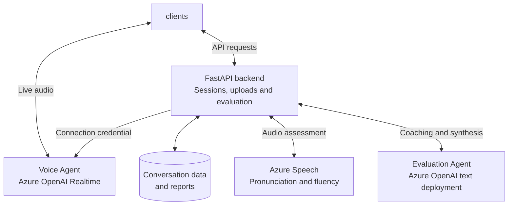

# Spoken Agents

Spoken Agents helps learners practice spoken English through two agents: a **Voice
Agent** for live conversation and an **Evaluation Agent** for feedback after practice.
The project provides iOS and web clients that share the same backend.

## Voice Agent

The Voice Agent uses **Azure OpenAI Realtime** to communicate directly with the
learner over WebRTC. It listens and responds with speech, adapting the conversation
to the learner's speaking goal, level, and preferred topic.

The backend creates the practice session and issues a short-lived connection
credential. The client then connects directly to the Voice Agent for live audio
and conversation events. Provider keys stay on the backend.

During practice, the client records learner turns and saves finalized learner and
agent transcripts through the backend API. These recordings and transcripts become
the evidence used by the Evaluation Agent.

## Evaluation Agent

The Evaluation Agent uses a separate **Azure OpenAI text deployment** to review the
saved conversation. It evaluates the learner's language and provides corrections,
strengths, and practical next steps.

**Azure Speech** assesses each learner recording as it is uploaded, and the backend
caches its pronunciation and fluency measurements.
The Evaluation Agent combines available speech measurements with transcript coaching
into a final report. Transcript coaching remains available when speech assessment
is unavailable.

The client requests evaluation after practice ends and submits its final upload
manifest. The backend checks completeness, reads the saved conversation and cached
speech results, and calls the Evaluation Agent. Reports are stored for later review.

## Backend architecture

The **FastAPI backend** coordinates session creation, account verification, uploads,
and evaluation. Account ownership checks keep each learner's sessions and reports
separate. Stable upload identifiers and completeness checks support retries and
prevent evaluation of an incomplete conversation.

Live conversation and evaluation use separate model deployments: the Voice Agent
handles immediate spoken interaction, while the Evaluation Agent reviews saved
evidence after practice. Azure Speech supplies acoustic measurements for that review.

Persistence uses **SQLite** locally and supports lease-protected SQLite snapshots
in **Azure Blob Storage** for low-volume hosted use. **Azure Functions** hosts the
API and runs scheduled cleanup for inactive sessions.

## Further documentation

- [Session API](docs/sessions-api-contract.md)
- [Evaluation API](docs/evaluation-api-contract.md)
- [Pronunciation assessment](docs/pronunciation-api-contract.md)
- [Conversation completeness](docs/session-recovery-and-completeness.md)
- [Account isolation](docs/account-isolation-api-contract.md)
- [Hosted storage](docs/hosted-storage-api-contract.md)
