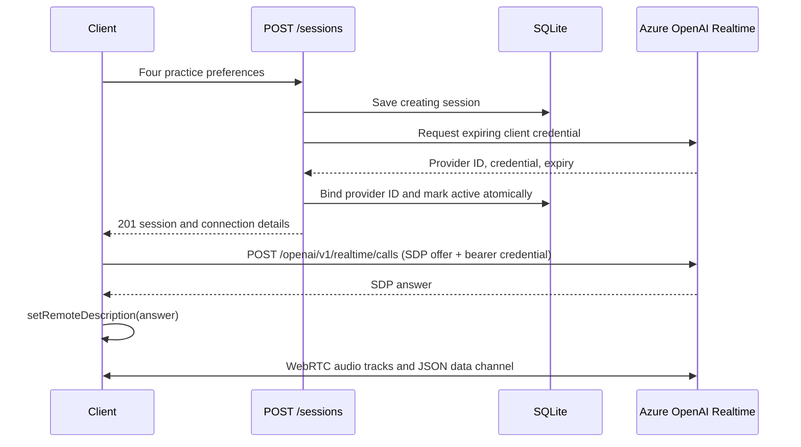

# Current architecture: start one session

The project uses data/settings classes and ordinary service functions.
See the [README](../README.md) for the class-by-class explanation.

`app/main.py` handles HTTP. `app/services/sessions.py` coordinates the workflow.
`app/services/realtime.py` calls Azure OpenAI. `app/storage/sqlite.py` stores session
metadata without credentials. `app/schemas.py` defines request and response data.
`app/config.py` loads server settings.

A provider failure marks the application session failed. Activation failure withholds
the credential; the token expires after 60 seconds. Database failure or a process
crash can leave a creating row; the timer marks creating rows older than five minutes failed.

The client establishes the actual live connection after credential creation.
An active application row means that the credential was prepared successfully.
The provider ID returned here is from credential configuration, not a WebRTC call ID.

`GET /practice` serves the browser form. `app/static/practice.mjs` binds its controls;
`app/static/realtime.mjs` manages microphone permission, SDP negotiation, playback,
events, and cleanup. Audio flows directly to Azure. Disconnect stops local media
without changing stored session status. See the
[browser contract](todo-browser-webrtc-api-contract.md) for lifecycle and tests.

## Deferred features

Learner recording and finalized transcript uploads are implemented. Agent transcript capture is also implemented.
Evaluation and retention remain deferred. Their old schemas, ports, routes, and placeholder
classes have been removed. Per-user authentication, rate limiting, and browser recording/upload integration remain future work.

## Learner input storage

The two PUT routes in `app/main.py` accept a complete audio body or a finalized
learner transcript. `app/services/learner_inputs.py` maps persistence outcomes to
HTTP receipts/errors. `store_learner_input()` uses a SQLite transaction with an
immediate write lock to prevent concurrent uploads from losing components or
creating duplicates. A failure rolls back the entire component write.

The additive `learner_turns` table stores audio bytes and transcript JSON in one
row per `(session_id, turn_id)`, with separate receipt timestamps. No external
provider is called during capture, and session state is unchanged. Audio is bounded
to 10 MiB while reading the request; SQLite work runs off the async event loop.

The browser must record learner microphone audio and forward finalized learner
text with a stable turn ID. Audio and transcript can arrive independently. There
is no evaluation worker or browser integration for these uploads yet.

## Agent transcript storage

`app/services/agent_transcripts.py` validates playback metadata and coordinates
`store_agent_transcript()`. The additive `agent_transcripts` table stores immutable
content parts under `(session_id, item_id, content_index)`. SQLite serializes writes
so duplicate concurrent uploads produce one row. Learner tables remain unchanged.

Provider predecessor IDs and optional client playback offsets retain ordering
context. Server receipt time is not chronological turn order. Ingestion accepts
missing predecessors; resolving the complete conversation remains future work.
See [the agent-transcript contract](todo-agent-transcripts-api-contract.md).

## Session ending

`POST /sessions/{session_id}/end` calls `end_session()` and then
`end_stored_session()`. An immediate SQLite transaction serializes concurrent end
requests, adds the `ended_at` column for older databases, and changes active to
ended with a UTC timestamp. Retries return the stored timestamp. Provider metadata
and captured inputs are preserved. Creating and failed sessions cannot be ended.

Both capture helpers accept active and ended sessions to support delayed uploads.
Ending does not close WebRTC, establish upload completeness, or run evaluation.

## Activity and stale sessions

The heartbeat route calls `heartbeat_session()` and `heartbeat_stored_session()`.
Activation and acknowledged uploads also update server-owned `last_activity_at`.
`migrate_session_lifecycle()` adds lifecycle columns under an immediate transaction
and backfills older sessions from `created_at`. Old ended sessions receive the
`client_requested` reason.

The Azure timer invokes `expire_inactive_sessions()` every minute with a five-minute
threshold. Its database transaction serializes with heartbeats, ending, and uploads.
Only active rows expire. Late uploads do not touch ended session metadata. Timer
storage failures propagate so the host records a failed invocation. Uvicorn alone
does not execute the timer, and hosted cleanup requires a shared durable database.

## Start deduplication and completeness

Session insertion atomically reserves an optional unique idempotency key. Keyed
replays read the current session and return no credential; creating replays return
a retryable conflict. State transitions out of creating are conditional so stale
creation cleanup cannot be undone by a delayed provider response.

`app/storage/completeness.py` compares an immutable final upload manifest with a
transactional snapshot of received learner components and agent content parts.
`app/services/completeness.py` normalizes manifests and maps storage outcomes to
HTTP errors. Readiness is derived, not a permanent flag; late undeclared input makes
it false again. See [the contract](session-recovery-and-completeness.md).
