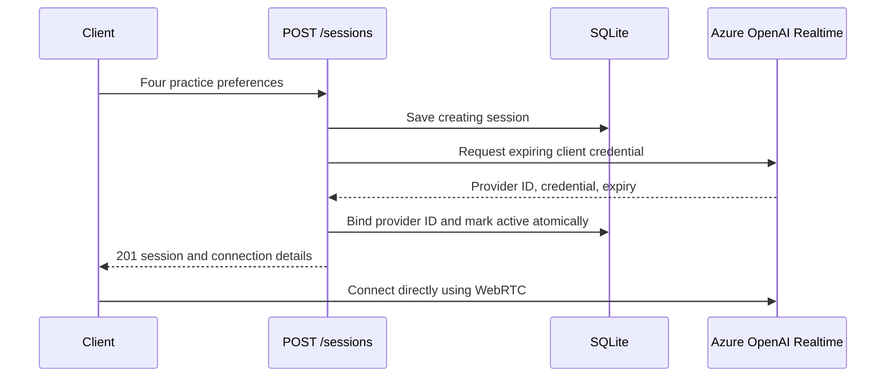

# Current architecture: start one session

The project uses data/settings classes and ordinary service functions.
See the [README](../README.md) for the class-by-class explanation.

`app/main.py` handles HTTP. `app/services/sessions.py` coordinates the workflow.
`app/services/realtime.py` calls Azure OpenAI. `app/storage/sqlite.py` stores session
metadata without credentials. `app/schemas.py` defines request and response data.
`app/config.py` loads server settings.

A provider failure marks the application session failed. Activation failure withholds
the credential; the token expires after 60 seconds. Database failure or a process
crash can leave a creating row; reconciliation is not implemented yet.

The client establishes the actual live connection after credential creation.
An active application row means that the credential was prepared successfully.
The provider ID returned here is from credential configuration, not a WebRTC call ID.

## Deferred features

Learner recording and finalized transcript uploads are implemented. Agent transcript capture is also implemented.
Evaluation, ending, and retention remain deferred. Their old schemas, ports, routes, and placeholder
classes have been removed. Authentication, rate limiting, idempotency, recovery,
and a browser/WebRTC client remain future work.

## Learner input storage

The two PUT routes in `app/main.py` accept a complete audio body or a finalized
learner transcript. `app/services/learner_inputs.py` maps persistence outcomes to
HTTP receipts/errors. `store_learner_input()` uses a SQLite transaction with an
immediate write lock to prevent concurrent uploads from losing components or
creating duplicates. A failure rolls back the entire component write.

The additive `learner_turns` table stores audio bytes and transcript JSON in one
row per `(session_id, turn_id)`, with separate receipt timestamps. No external
provider is called during capture, and session state is unchanged. Audio is bounded
to 10 MiB while reading the request; SQLite work runs off the async event loop.

The browser must record learner microphone audio and forward finalized learner
text with a stable turn ID. Audio and transcript can arrive independently. There
is no evaluation worker or browser implementation yet.

## Agent transcript storage

`app/services/agent_transcripts.py` validates playback metadata and coordinates
`store_agent_transcript()`. The additive `agent_transcripts` table stores immutable
content parts under `(session_id, item_id, content_index)`. SQLite serializes writes
so duplicate concurrent uploads produce one row. Learner tables remain unchanged.

Provider predecessor IDs and optional client playback offsets retain ordering
context. Server receipt time is not chronological turn order. Ingestion accepts
missing predecessors; resolving the complete conversation remains future work.
See [the agent-transcript contract](todo-agent-transcripts-api-contract.md).
