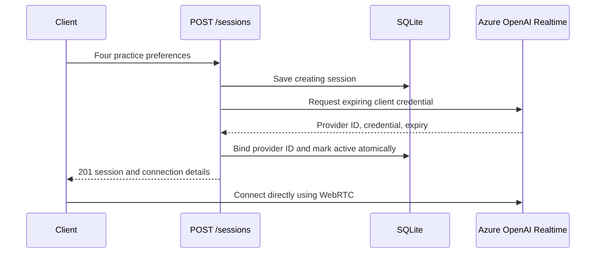

# Current architecture: start one session

The project has six data/settings classes and no service inheritance hierarchy.
See the [README](../README.md) for the class-by-class explanation.

`app/main.py` handles HTTP. `app/services/sessions.py` coordinates the workflow.
`app/services/realtime.py` calls Azure OpenAI. `app/storage/sqlite.py` stores session
metadata without credentials. `app/schemas.py` defines request and response data.
`app/config.py` loads server settings.

A provider failure marks the application session failed. Activation failure withholds
the credential; the token expires after 60 seconds. Database failure or a process
crash can leave a creating row; reconciliation is not implemented yet.

The client establishes the actual live connection after credential creation.
An active application row means that the credential was prepared successfully.
The provider ID returned here is from credential configuration, not a WebRTC call ID.

## Deferred features

Introduce recording uploads, transcript events, evaluation, ending, and retention
only when implementing those flows. Their old schemas, ports, routes, and placeholder
classes have been removed. Authentication, rate limiting, idempotency, recovery,
and a browser/WebRTC client remain future work.
