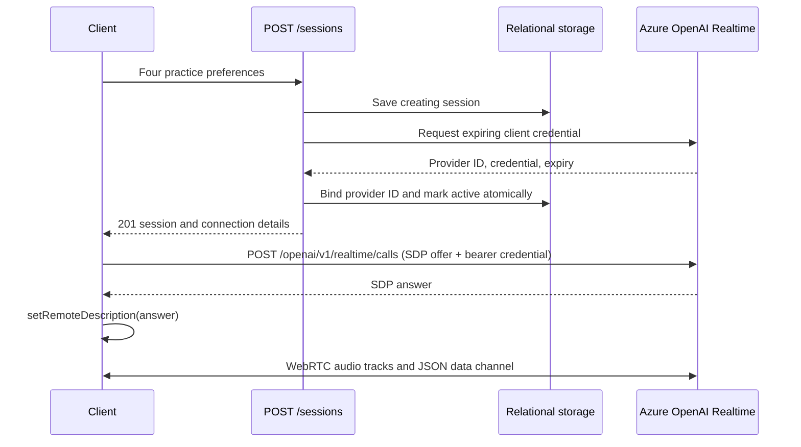

# Current architecture: start one session

The project uses data/settings classes and ordinary service functions.
See the [README](../README.md) for the class-by-class explanation.

`backend/app/main.py` handles HTTP. `backend/app/services/sessions.py` coordinates the workflow.
`backend/app/services/realtime.py` calls Azure OpenAI. `backend/app/storage/sqlite.py` stores session
metadata without credentials. `backend/app/schemas.py` defines request and response data.
`backend/app/config.py` loads server settings.

## Account isolation boundary

FastAPI maps verified Entra identities to opaque accounts and checks session
ownership inside storage transactions. The browser verifies `/me` before practice,
scopes saved reports to the account, and rejects changed-account requests. The iOS
client uses MSAL to verify `/me` and select its local history and queued work. See the [account isolation API contract](account-isolation-api-contract.md)
and [implementation plan](account-isolation-plan.md). Hosted Azure identity-header
trust and two-account conversations still require deployment verification.
Database-backed account quotas apply to protected requests; edge throttling of
invalid-token traffic remains a public deployment gate.

A provider failure marks the application session failed. Activation failure withholds
the credential; the token expires after 60 seconds. Database failure or a process
crash can leave a creating row; the timer marks creating rows older than five minutes failed.

The client establishes the actual live connection after credential creation.
An active application row means that the credential was prepared successfully.
The provider ID returned here is from credential configuration, not a WebRTC call ID.

`backend/web_app.py` optionally serves the browser form at `GET /practice`. `browser/public/practice.mjs` binds its controls;
`browser/public/realtime.mjs` manages microphone permission, SDP negotiation, playback,
events, and cleanup. Live audio flows directly to Azure; learner recordings also
go to the backend for persistence and Speech assessment. Disconnect stops local
media and, through `browser/public/practice.mjs` and `browser/public/session.mjs`,
requests session ending and upload finalization. See the
[browser contract](browser-webrtc-api-contract.md) for lifecycle and tests.

## Implemented capture and evaluation

Learner recording and finalized transcript uploads are implemented. Agent transcript capture is also implemented.
Evaluation is implemented through POST/GET `/sessions/{session_id}/evaluation` in
`backend/app/main.py`, coordinated by `backend/app/services/evaluations.py`.
`backend/app/storage/evaluations.py` persists immutable input snapshots, attempt
status, and results; completed requests replay the saved result. New evaluations
require an ended session with a complete manifest and at least one learner transcript
(`backend/app/storage/completeness.py`). `backend/tests/test_evaluations.py` covers
creation, retrieval, replay, readiness rejection, provider failures, and retry.

The [incremental evaluation contract](evaluation-api-contract.md) separates a 10 MiB
canonical snapshot limit from model context admission. Finalized transcript uploads
start checkpointed background work once accumulated evidence reaches 200,000 bytes;
the existing hosted maintenance timer also advances active sessions. Evidence windows,
validated source spans and bounded ID-based reduction feed whole-session scoring.
Final POSTs reconcile immutable source coverage and resume unfinished work with 202;
the browser advances these checkpoints automatically. The implementation lives in
`backend/app/services/evaluation_batches.py`; context admission conservatively counts
UTF-8 bytes with output and safety reserves rather than using an exact tokenizer.

## Hosting and scaling limits

- **Storage.** The East US Function App connects to PostgreSQL 16 in Central US
  through Private Link with TLS hostname verification. PostgreSQL holds account,
  session, transcript, and evaluation data. The private recording container holds
  learner audio, and PostgreSQL stores its references. The live pool is capped at
  one connection per worker. See the [hosted storage contract](hosted-storage-api-contract.md)
  and [cutover record](releases/release-2026-11-11-postgres.md).
- **Retention.** The backend has no age-based purge or user deletion workflow for
  recordings, transcripts or reports. Inactivity expiry changes session status.
  Deleting a practice in iOS removes local data, and forgetting a report in the
  browser removes its local reference. Server retention, deletion, and how backups
  and restores should handle deleted data remain undefined in the application.
  See the [iOS design](ios-app-design.md) and [browser contract](browser-webrtc-api-contract.md).
- **Background work and provider limits.** Speech and text evaluation each admit up to
  two concurrent provider calls per application process. Text evaluation persists
  checkpoints and uses shared leases to coordinate work for each session. Uploads
  and the hosted timer can advance active sessions. The process limits add up across
  workers. Speech has no durable cross-instance queue, and the application has no
  shared provider concurrency limit across sessions. See the
  [pronunciation](pronunciation-api-contract.md) and [evaluation](evaluation-api-contract.md) contracts.
- **Evaluation quality.** The text evaluator validates structured output and checks
  quotations against source text. Feedback quality on real learner recordings,
  score consistency, and long-session latency and cost remain open. See the
  [evaluation contract](evaluation-api-contract.md).

## PostgreSQL transaction boundaries

| Workflow | What the database coordinates |
| --- | --- |
| Accounts and session creation | A unique identity maps to one account. An account-scoped idempotency key reserves one session. Quota counters update atomically, and a rejected quota check rolls back all counters for that request. |
| Session lifecycle and evidence | The session row lock coordinates uploads, ending, manifest checks, and final evaluation snapshot capture. Ownership checks run in the storage transaction. |
| Recording registration and cleanup | Upload bytes before opening the registration transaction. Under the session row lock, recheck ownership and object presence before committing the reference. The orphan sweep takes the same lock and rechecks the reference before deleting. |
| Evaluation jobs | The plan row lock coordinates a session's work claim and budget. Provider calls run outside the transaction. Attempt and lease tokens prevent stale work from overwriting newer results. |

SQLite remains available for local development. The frozen hosted SQLite snapshot
is the pre-cutover backup. Use the active PostgreSQL database for recording
maintenance and preserve PostgreSQL writes during recovery. Production load and
startup latency after cutover have yet to be measured. See the
[hosted storage contract](hosted-storage-api-contract.md).

## Learner input storage

The two PUT routes in `backend/app/main.py` accept a complete audio body or a finalized
learner transcript. `backend/app/services/learner_inputs.py` maps persistence outcomes to
HTTP receipts and errors. `store_learner_input()` locks the session row in
PostgreSQL and uses an immediate transaction in SQLite. Concurrent uploads can
commit distinct components without creating duplicates. A failure rolls back
the entire component write.

The `learner_turns` table stores transcript JSON and audio receipt metadata per
`(session_id, turn_id)`. With object storage enabled, `learner_recordings` stores the
immutable Blob reference, size and hash. Existing inline bytes remain readable.
Audio capture then calls
`assess_uploaded_audio()` synchronously through `backend/app/services/learner_inputs.py`;
transcript capture does not call a provider. Uploads preserve session status and
refresh activity only while active. Audio is bounded
to 10 MiB while reading the request, and database work runs off the async event loop.

`browser/public/recorder.mjs` records learner microphone turns; callbacks in
`browser/public/practice.mjs` connect recordings and provider events to
`browser/public/session.mjs`. Its `SessionSync` uploads audio and finalized learner
text under the same stable turn UUID. Audio and transcript can arrive independently;
identical retries are acknowledged and changed content conflicts
(`backend/app/storage/sqlite.py`, `backend/tests/test_learner_inputs.py`).
`browser/tests/session.test.mjs` covers shared audio/transcript IDs, retries, and
manifest finalization. Transcript uploads and the hosted maintenance timer advance
incremental evaluation in the background; the browser requests and advances final
evaluation after saving a complete session. See
[the evaluation contract](evaluation-api-contract.md).

## Agent transcript storage

`backend/app/services/agent_transcripts.py` validates playback metadata and coordinates
`store_agent_transcript()`. The additive `agent_transcripts` table stores immutable
content parts under `(session_id, item_id, content_index)`. Transactions serialize
writes to the same session so duplicate concurrent uploads produce one row.

Provider predecessor IDs and optional client playback offsets retain ordering
context. Server receipt time is not chronological turn order. Ingestion accepts
missing predecessors. `browser/public/session.mjs` uploads finalized
`response.output_audio_transcript.done` events, deduplicates content identities,
and reports playback as `unknown`; it does not supply predecessor IDs or playback
offsets (`browser/tests/session.test.mjs`). New evaluation snapshots combine learner
turns and timed agent parts on the shared session clock. They keep untimed agent
parts separately. Storage ordering metadata and retry behavior are covered by
`backend/tests/test_agent_transcripts.py`.
See [the agent-transcript contract](agent-transcripts-api-contract.md).

## Session ending

`POST /sessions/{session_id}/end` calls `end_session()` and then
`end_stored_session()` in `backend/app/storage/sqlite.py`. A transaction serializes
concurrent end requests and changes active to ended with a UTC timestamp and
`end_reason='client_requested'`. Retries return the stored timestamp. Provider metadata
and captured inputs are preserved. Creating and failed sessions cannot be ended.

Both capture helpers accept active and ended sessions to support delayed uploads.
The end API does not close WebRTC, establish upload completeness, or run evaluation.
`backend/tests/test_session_ending.py` covers idempotency, concurrent ending,
invalid states, and late uploads.

In the browser, `browser/public/realtime.mjs` closes WebRTC and local media, then
notifies `browser/public/practice.mjs` to call `SessionSync.finish()` in
`browser/public/session.mjs`. Finalization requests `/end`, waits for recordings
and uploads, retries failed saves, and submits the immutable upload manifest.
Feedback requires server readiness plus the browser's successful capture/upload
checks; missing transcripts keep it unavailable. `browser/tests/session.test.mjs`
covers this ordering and failure handling. Page exit requests keepalive ending,
but does not guarantee completion of asynchronous uploads or manifest submission.

## Activity and stale sessions

The heartbeat route calls `heartbeat_session()` and `heartbeat_stored_session()`.
Activation and acknowledged uploads also update server-owned `last_activity_at`.
`migrate_session_lifecycle()` adds lifecycle columns under an immediate transaction
and backfills older sessions from `created_at`. Old ended sessions receive the
`client_requested` reason.

The Azure timer invokes `expire_inactive_sessions()` every minute with a five-minute
threshold. Its database transaction serializes with heartbeats, ending, and uploads.
The timer ends inactive active sessions, fails stale creating sessions, and runs
a bounded scan to advance incremental evaluation for active sessions. Late uploads
do not touch ended session metadata. Timer
storage failures propagate so the host records a failed invocation. Uvicorn alone
does not execute the timer, and hosted cleanup requires a shared durable database.

## Start deduplication and completeness

Session insertion atomically reserves an optional unique idempotency key. Keyed
replays read the current session and return no credential; creating replays return
a retryable conflict. State transitions out of creating are conditional so stale
creation cleanup cannot be undone by a delayed provider response.

`backend/app/storage/completeness.py` compares an immutable final upload manifest with a
transactional snapshot of received learner components and agent content parts.
`backend/app/services/completeness.py` normalizes manifests and maps storage outcomes to
HTTP errors. Readiness is derived, not a permanent flag; late undeclared input makes
it false again. See [the contract](session-recovery-and-completeness.md).

## Client boundaries

`backend/app/main.py` contains only the shared API. Browser files and their JavaScript
tests live in `browser/public/` and `browser/tests/`. The optional `backend/web_app.py`
wrapper serves those assets and mounts the API at `/`; omitting assets leaves the
API available. Azure uses that wrapper to preserve the existing optional practice
page. The iOS client in `mobile/` calls the same HTTP endpoints. Each client owns
its WebRTC connection, local recovery and report handling, so those flows need
verification on both platforms.

The deployed provider and hosting integrations use Azure OpenAI Realtime and text
endpoints, Azure Speech, Azure Functions, PostgreSQL, and Blob recording storage. The session API
passes the provider WebRTC URL and temporary credential to both clients. A provider
change must account for credential issuance, SDP exchange and event compatibility.

Python tests live in `backend/tests/`; root `pytest.ini` makes `app` imports resolve
from `backend/`. The packaging script preserves Azure's required archive-root layout.

## Speech assessment

The audio-upload workflow calls `services/pronunciation.py` to decode each learner
recording and obtain context-free Azure Speech scores immediately. Per-turn outcomes,
including unavailable configuration/provider states, are cached in `speech_assessments`.
Two provider slots per process bound simultaneous Speech calls. Final evaluation
snapshots audio hashes and transcripts, persists a transcript-only Azure OpenAI
result, and waits if any expected audio hash lacks a terminal cache result. It then
uses a separate small synthesis schema for summary, strengths and next steps while
copying transcript categories and corrections unchanged. `services/speech_worker.py` isolates continuous Speech
SDK recognition in a process with a parent-enforced timeout; final results retain the
evaluation attempt fence.
Speech credentials are independent of Azure OpenAI. See the
[pronunciation contract](pronunciation-api-contract.md) for limits and coverage.
