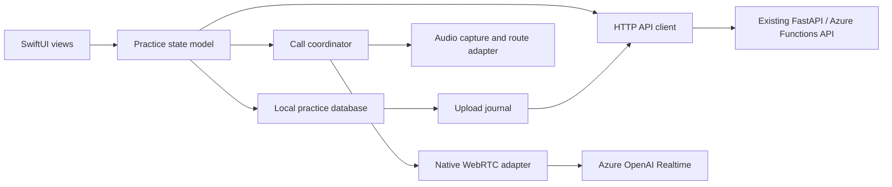

# iOS speaking practice app design

**Status:** Phase 2 foreground practice loop passed its simulator gate; durable history, uploads, feedback, and device verification remain.\
**Client:** SwiftUI on iPhone, with a native WebRTC transport.\
**Backend:** The existing HTTP API in `backend/app/main.py`.

## Goal

Give a learner the same core practice loop as the browser: choose a speaking goal,
have a voice conversation, end it, and read one coaching report. The app uses the
existing session, capture, completeness, and evaluation APIs. It does not import
browser JavaScript or duplicate backend evaluation logic.

The first release supports one foreground conversation at a time. It targets a
physical iPhone; the simulator is useful for layout and API tests but is not the
acceptance environment for microphone, audio routing, or live WebRTC.

## Product flow

1. **Setup:** Choose a speaking goal, CEFR level, optional topic (including “Let
   the agent choose”), and duration. Validate against the
   [session contract](sessions-api-contract.md) before starting.
2. **Connect:** Request microphone access, prepare the audio session and WebRTC
   peer, then create a backend session. Show distinct permission, connecting, and
   ready states. A session is not presented as connected merely because the API
   returned `active`.
3. **Practice:** Play the agent's opening question. Provide **Start speaking** and
   **Finish turn** controls, an audio output control, visible learner and agent
   transcripts, and **End & get feedback**. Keep these controls reachable while the
   transcript scrolls. Show when a turn is recording, transcribing, or saving.
4. **Finish:** Stop any active turn, wait briefly for its final transcript, close
   media, end the backend session, finish uploads, declare the final inventory, and
   request evaluation only when `ready_for_evaluation` is true. Display saving and
   assessment progress independently.
5. **Practice history:** List past practices from the local database, newest first.
   Opening one shows its locally saved conversation and report, including offline.
   An interrupted or incomplete practice remains visible with its actual status and
   a retry action where saved uploads can still be sent.
6. **Report:** Show the overall summary, grammar, vocabulary, coherence,
   pronunciation and spoken fluency when assessed, strengths, next steps, and
   grounded corrections. Say “Not assessed” where the API lacks speech evidence.
   Cache each completed report locally. When online and authenticated, refresh it
   through `GET /sessions/{session_id}/evaluation` without making the cached copy
   depend on server availability.

An unfinished call or unsaved upload is not silently represented as a completed
report. If saving fails, keep the pending components and a clear recovery action.

## Client architecture



- **SwiftUI views** render setup, conversation, saving, and report screens. They
  receive state and send user actions; they do not own network requests or media.
- **Practice state model** is the single authority for one attempt's lifecycle.
  Suggested states: `idle`, `requestingPermission`, `connecting`, `ready`,
  `recording`, `waitingForTranscript`, `finishing`, `evaluating`, `completed`, and
  `failed`. Each asynchronous callback carries an attempt identifier so a late
  result cannot revive a cancelled call.
- **HTTP API client** decodes typed responses, uses bounded timeouts, honors
  `Retry-After`, and maps server failures to safe user messages. It never logs
  credentials, audio, transcripts, or raw provider error bodies.
- **Call coordinator** serializes WebRTC events, turn IDs, response generation,
  cancellation, heartbeat, and cleanup. The WebRTC adapter owns peer connection,
  SDP negotiation, the `oai-events` data channel, and remote audio.
- **Audio adapter** configures iOS microphone permission, `AVAudioSession`, output
  route changes, interruptions, and a per-turn recording. The recording must
  contain learner microphone input only and use a backend-supported format.
- **Local practice database** persists session metadata, conversation text,
  upload state, and cached evaluations. SwiftData is the proposed persistence
  layer if the supported devices allow an iOS 17 minimum; otherwise use a
  SQLite-backed Core Data store. Include schema migration tests before release.
  The database drives the history list and is the source for offline revisits.
- **Upload journal** stores pending turn IDs, immutable upload payloads, receipts,
  and the final manifest until each operation is acknowledged. Audio bytes live in
  protected files referenced by database rows, rather than in database BLOBs.
  It provides byte-identical retries after relaunch.

Keep the API base URL in build configuration. Do not ship provider resource keys or
Azure Function keys in the app. The temporary Realtime credential is held in memory
only and passed to the returned HTTPS `webrtc_url` for SDP exchange.

## Local practice database and revisit behavior

Persist every backend session as soon as `POST /sessions` returns its session ID.
Keep the UUID idempotency key with the local attempt so a network retry does not
create another practice by accident. A session enters **History** when conversation
content exists; a setup failure with no practice content can be removed after
cleanup. Use stable provider IDs and turn UUIDs as uniqueness keys, so repeated
events or network responses update the same record.

| Record | Locally stored fields | Purpose |
|---|---|---|
| Practice session | Local attempt ID, backend session ID, start/end times, preferences, lifecycle status, last update, idempotency key | Populate history and resume save work. |
| Conversation part | Learner turn UUID or agent item ID/content index, speaker, final text, session-clock offsets, playback status when known | Revisit the conversation offline and build the final upload inventory. |
| Upload item | Component identity, immutable JSON payload or protected audio-file path, MIME type, content hash, receipt state, last error | Retry the original bytes and JSON without changing an accepted component. |
| Evaluation snapshot | Session ID, full saved evaluation response, retrieval time | Reopen the complete coaching report offline. |

Write an intended turn and its capture state before starting network uploads.
Persist final transcript text, agent parts, and completed recording file references
before acknowledging them in the UI. Persist the final manifest before sending it;
persist each upload and manifest receipt after server acknowledgment. Database writes and file moves need a
recoverable sequence: on launch, reconcile missing files and unfinished writes,
then show each affected practice as incomplete rather than silently dropping it.

The history screen shows goal, topic, practice date, duration, and a status such as
**Feedback ready**, **Saving incomplete**, or **Feedback unavailable**. Detail
opens the saved conversation and any cached report. A completed practice can be
revisited without a network connection. When online, the app may fetch a newer
evaluation for a known session ID and replace the cached snapshot after decoding
it successfully. A 404 or network error does not erase a locally cached report.
An incomplete practice can retry pending uploads, check data status, and request
evaluation where the backend session is already ended. It cannot resume an old
live WebRTC connection or obtain a new credential for that same session.

The current API has no session-list or transcript-read endpoint, so this local
database is the only source of practice history and conversation text on that
device. History does not sync across devices and is lost if the app is uninstalled
or its data is erased. Cross-device history would require authenticated backend
list/detail APIs and durable storage; that is separate backend work.

## Session and media protocol

The native client should mirror the established behavior in the
[browser WebRTC contract](browser-webrtc-api-contract.md), adapted for iOS media and
app lifecycle rules:

1. Obtain microphone permission before `POST /sessions`, since the returned
   Realtime credential lasts about 60 seconds. Generate one UUID
   `Idempotency-Key` for this intended start. A keyed replay can return
   `realtime: null`; it cannot restore a lost credential. In that case, end a known
   abandoned session when possible and start a new attempt with a new key.
2. Add a local audio track and `oai-events` data channel, create an SDP offer,
   `POST` it directly to `realtime.webrtc_url` with the temporary bearer
   credential, and apply the SDP answer. Request the opening response once the
   channel opens. Use the server-provided URL; do not construct a second endpoint
   in the app.
3. Use manual turns, as the browser does: disable server turn detection, clear
   the provider input buffer before recording, and mute/unmute input around each
   learner turn. On **Finish turn**, stop the local recording, commit the provider
   input buffer, and request the agent response. Associate the provider's
   committed item ID with the locally generated turn UUID before accepting the
   final learner transcript. Do not match turns by event arrival order.
4. Capture final agent transcript parts using their provider item ID and content
   index. Record playback as `completed`, `interrupted`, or `unknown` based on
   observed playback; generated text alone does not prove that audio was heard.
5. Send `POST /sessions/{session_id}/heartbeat` about every 30 seconds while
   active. Stopping local media does not itself end the backend row.

For each learner turn, upload the complete recording as raw binary to
`PUT /sessions/{session_id}/learner-turns/{turn_id}/audio` and the final text and
session-clock offsets to the matching `/transcript` endpoint. Supported audio MIME
types are `audio/webm`, `audio/ogg`, `audio/wav`, `audio/mp4`, and `audio/mpeg`;
the current per-turn limit is 10 MiB. Prefer a format whose recording and backend
decode path pass an end-to-end device test. Never upload a truncated container.
The [learner-input contract](learner-inputs-api-contract.md) defines validation and
retry behavior; the [agent-transcript contract](agent-transcripts-api-contract.md)
defines agent-part identity and playback metadata.

Finishing follows one ordered workflow:

```text
stop active recording -> collect final transcript -> end session
-> retry pending uploads -> PUT immutable upload manifest
-> GET data status if needed -> POST evaluation -> show saved report
```

The manifest lists every intended audio, learner transcript, and agent transcript
component, including components still missing after retries. A changed manifest
conflicts with the first one, so build it from the journal before sending it. Do
not start paid evaluation while completeness reports missing or unexpected data.
`POST /evaluation` can return a completed result, a saved result, or `202` while
speech processing catches up; follow the documented retry interval. See
[completeness](session-recovery-and-completeness.md) and
[evaluation](evaluation-api-contract.md).

## Authentication, privacy, and hosting

The hosted browser currently depends on Azure platform Microsoft sign-in and a
browser session cookie. A native iOS authentication path is **not yet implemented**
by this repository. Before a hosted iOS release, define and verify an Entra-based
native sign-in flow and a backend access policy that accepts the resulting token,
or another server-mediated flow that preserves the existing protected API. Do not
embed a Function key or reuse browser cookies as an undocumented native API.
Application-level user ownership and rate limiting also remain backend work before
multi-user public use.

Use HTTPS for hosted requests. Protect the local database, cached report, and
pending audio files with iOS file protection; exclude their contents from ordinary
logs and cloud backups unless an explicit backup policy is chosen. Remove
acknowledged audio after evaluation and keep its transcript and coaching report
for history. Offer **Delete from this device**, which removes local conversation,
report, and pending files but does not claim to delete server data. On sign-out,
clear the previous account's local practice data or keep it inaccessible until
that same account signs in again; test account switching. The hosted database must
be durable before promising server-side report retention across restarts or
instances; see the
[hosted storage contract](hosted-storage-api-contract.md).

Foreground practice is the first-release policy. On interruption, route loss,
backgrounding, or termination, stop recording and prevent late callbacks from
restarting media. Where execution time permits, end the known session and preserve
pending uploads for recovery. Background calling and automatic reconnection require
separate product and platform design; they are outside this release.

## Delivery plan and acceptance

| Milestone | Implementation | Acceptance |
|---|---|---|
| 1. Device prototype | SwiftUI shell, microphone permission, audio route, native WebRTC, Azure SDP and data-channel exchange | A physical iPhone hears the opening question and sends one spoken turn. Recording the same microphone input while WebRTC is active is proven without clipped or duplicate audio. |
| 2. Practice loop | Setup, call states, manual turns, transcript display, heartbeat, cancellation and cleanup | One complete foreground conversation; permission denial, setup timeout, transport loss, phone call, and route change have understandable outcomes. |
| 3. History, capture, and report | Local database, conversation history, learner and agent uploads, retry journal, end, manifest, evaluation | Identical retries succeed; incomplete uploads block feedback; multiple past practices and their cached reports reopen offline after app relaunch. |
| 4. Hosted release | Native sign-in, durable storage validation, accessibility, privacy review, TestFlight | Protected hosted API works without a bundled secret; real-device end-to-end session yields a report; VoiceOver and Dynamic Type keep controls usable. |

## Test strategy

Use deterministic fakes for HTTP, WebRTC events, the clock,
and file operations in automated tests. Reserve live provider tests for a physical
device and a controlled test account.

| Layer | Required cases | Pass condition |
|---|---|---|
| Local database | Create several practices, persist learner and agent parts, relaunch, sort history, open an old conversation and cached report offline | All records survive relaunch with the same IDs, order, text, status, and report. |
| Identity and migration | Deliver duplicate provider events and upload receipts; migrate an older database schema; switch accounts | No duplicate turns or reports, no lost history after migration, and one account cannot see another account's local records. |
| Journal recovery | Terminate after writing an audio file, after queuing an upload, after server acceptance but before saving the receipt, and after manifest submission | Relaunch reconciles each state; retries send identical bytes/JSON and the same manifest; no completed report is fabricated. |
| Missing/corrupt local data | Remove a pending audio file or corrupt a cached report in a test fixture | The practice remains visible as incomplete; the app gives a recovery explanation and does not send a truncated upload or crash. |
| Practice state | Deny permission, time out setup, disconnect during each async step, interrupt recording, and receive late WebRTC events | Media closes once, the old attempt cannot restart, and the local status matches what was saved. |
| Backend integration | Run against the existing API with mocked Azure calls: create, capture, end, manifest, data status, `202` evaluation, and completed evaluation | Request bodies match contracts; retries and `Retry-After` work; incomplete data never triggers paid evaluation. |
| UI and accessibility | Open History and a report without network, delete one local practice, enlarge text, and use VoiceOver | Navigation and controls remain usable; deletion removes that practice's local records and files only. |

On a physical iPhone, run at least one full conversation with the real provider and
confirm the saved conversation and report still open in airplane mode after force
quit and relaunch. Repeat with speaker, wired or Bluetooth headphones, a phone or
system interruption, backgrounding, and a dropped network connection. Inspect the
uploaded audio for completeness and alignment with the learner transcript. A
simulator or mocked test cannot establish microphone quality, audio routing, or
live WebRTC compatibility.

The release gate is: all automated tests pass; no practice history is lost across
the supported schema migration and relaunch scenarios; a real-device session
produces a complete report; and no bundled Function key or provider secret is
present. Record the tested iOS versions, devices, and backend deployment used for
that gate.

## Decisions to resolve in the device prototype

- Select and pin an iOS WebRTC distribution after checking current maintenance,
  binary size, license, and compatibility with the supported Xcode/iOS versions.
- Choose the minimum iOS version based on the devices to support; no minimum is
  committed by this document.
- Prove a microphone capture path that can both feed WebRTC and produce a complete
  supported upload format for each manual turn without competing audio sessions.
- Set explicit local journal size and retention limits after measuring real turn
  recordings. The backend already rejects uploads over 10 MiB.
- Choose the retention and backup policy for locally cached conversation text and
  reports; make it clear to learners before release.
- Define the native authentication contract and per-user ownership behavior before
  a hosted multi-user release.

Platform references: [Azure Realtime WebRTC](https://learn.microsoft.com/en-us/azure/foundry/openai/how-to/realtime-audio-webrtc),
[Apple audio sessions](https://developer.apple.com/documentation/avfaudio/avaudiosession),
and [Apple microphone privacy](https://developer.apple.com/documentation/bundleresources/information-property-list/nsmicrophoneusagedescription).
